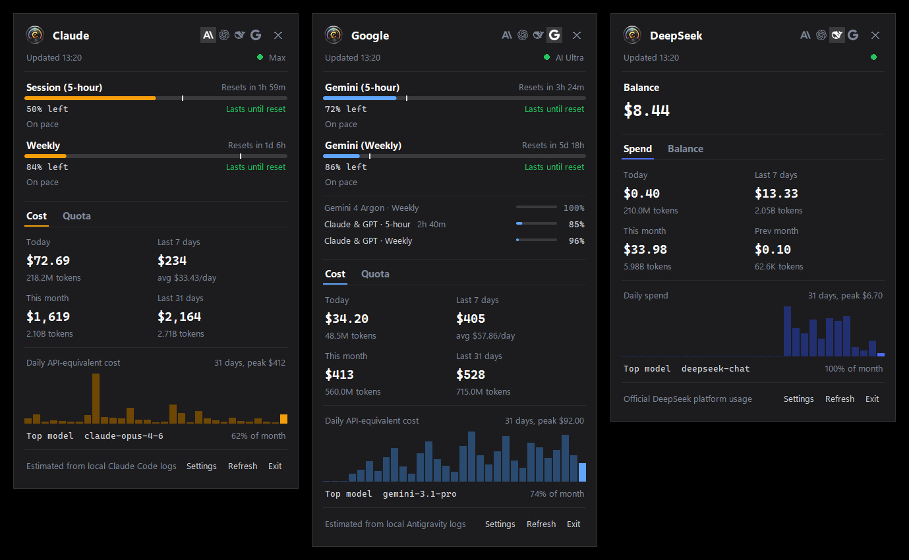
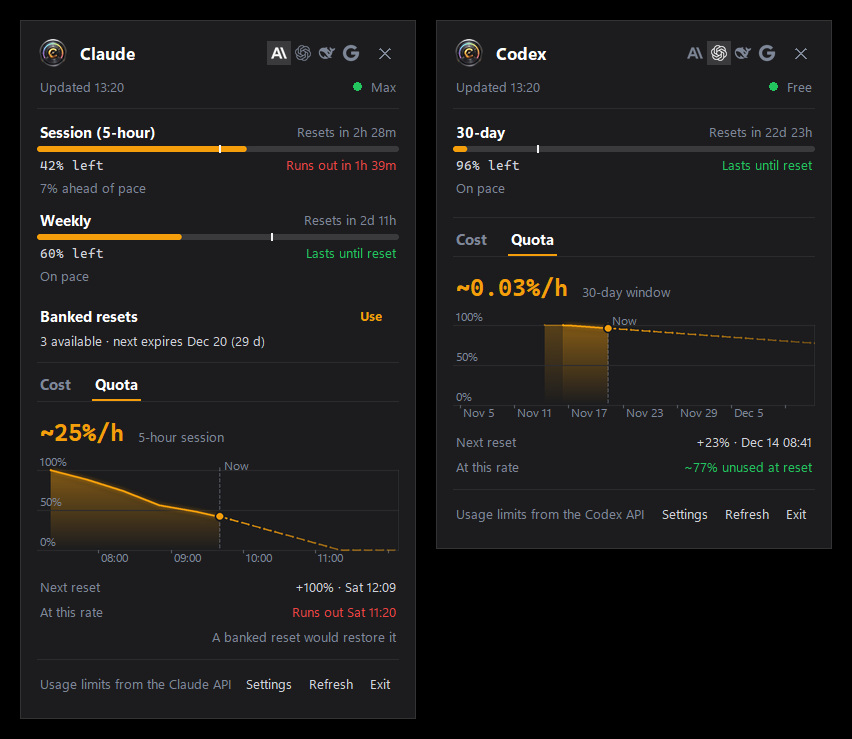

# ClaudeBar

Windows and Linux system tray app that tracks Claude Code, OpenAI Codex, DeepSeek, and Google Antigravity usage. Inspired by [CodexBar](https://github.com/steipete/CodexBar) for macOS.



## Providers

Switch providers from the header icons; right-click the tray icon for a quick summary of all active engines.

| Provider | What it shows | Authentication |
|---|---|---|
| Claude Code CLI | 5-hour and weekly limits, model-scoped weekly buckets, banked resets, local token and API-equivalent cost stats | Reads `~/.claude/.credentials.json`, `~/.claude/projects/`, and `~/.claude.json` fallback |
| Codex CLI | Session and weekly (or single long) limits, banked resets, top model, local token and API-equivalent cost stats | Reads `~/.codex/auth.json` and `~/.codex/` after `codex login` |
| DeepSeek | Account balance and billed UTC spend, token, and request totals | Browser sign-in in Settings, pasted `userToken`, or `DEEPSEEK_USER_TOKEN` |
| Google (Antigravity) | Gemini 5-hour and weekly limits, Argon/Carbon and Claude & GPT buckets, plan badge, local SQLite conversation costs | Isolated profile via Google's `agy` CLI (Sign in to Google in Settings; downloads and SHA-512 verifies `agy` if absent) |

Not supported: Claude Desktop, ChatGPT web (cookie auth), and GitHub Copilot (org/enterprise API only).

## Quota forecast and banked resets

The Quota tab (Balance on DeepSeek) charts burn rate and remaining quota against a projection to the next reset using readings saved in `quota_history.jsonl` (10-day retention). Premature run-out warnings are held back early in a fresh window. When Claude or Codex reports spendable banked resets, a Use button asks for confirmation before sending one request.



## Install

Download from [Releases](https://github.com/MarvinFS/Public/releases):

- Windows 10/11: run the signed `ClaudeBar-Setup-*.exe` installer, or run from source (`pip install -r requirements.txt && python src/main.py`, Python 3.11+).
- Linux (glibc 2.36+: Ubuntu 24.04, Debian 12, Rocky 10, and newer): download the self-contained `ClaudeBar` executable (`chmod +x ClaudeBar && ./ClaudeBar`), `.deb`, `.rpm`, or AppImage. All Linux assets are GPG-signed with `SHA256SUMS` and provenance attached.

Left-click the tray icon to open the panel, drag edges or corners to resize, use `Ctrl+plus`, `Ctrl+minus`, `Ctrl+wheel`, or `Ctrl+0` to zoom/reset, and press Escape to close.

## Build from source (Windows)

```powershell
.\build.ps1            # builds dist\ClaudeBar.exe (~14 MB)
.\build.ps1 -Install   # also copies it to Startup
.\build.ps1 -Clean     # clean rebuild
```

Run tests with `python -m pytest`. Custom `app_icon.png` and `app_icon.ico` files in `resources/icons/` override the default icon.

## Data and files

| Data | Windows | Linux |
|---|---|---|
| Settings (`config.json`) | `%LOCALAPPDATA%\ClaudeBar\` | `~/.config/claudebar/` |
| Log, cached snapshot, quota history | `%LOCALAPPDATA%\ClaudeBar\` | `~/.local/state/claudebar/` |
| Price and FX caches (`models.dev`) | `%LOCALAPPDATA%\ClaudeBar\` | `~/.cache/claudebar/` |
| DeepSeek token | DPAPI in `%LOCALAPPDATA%\ClaudeBar\secrets\` | Desktop keyring or `~/.local/share/claudebar/secrets/` |
| Isolated Google profile | `%LOCALAPPDATA%\ClaudeBar\antigravity\` | `~/.local/share/claudebar/antigravity/` |

Credentials are never stored in `config.json`. ClaudeBar never modifies Claude Code or Codex credentials; expired tokens display the last cached snapshot marked `(cached)` until refreshed in the CLI. Google access tokens (~1 hour) renew silently through `agy` against ClaudeBar's isolated profile.

Open the log from the tray menu (Open log file), or start with `--debug` for per-refresh logging.

## License

MIT
