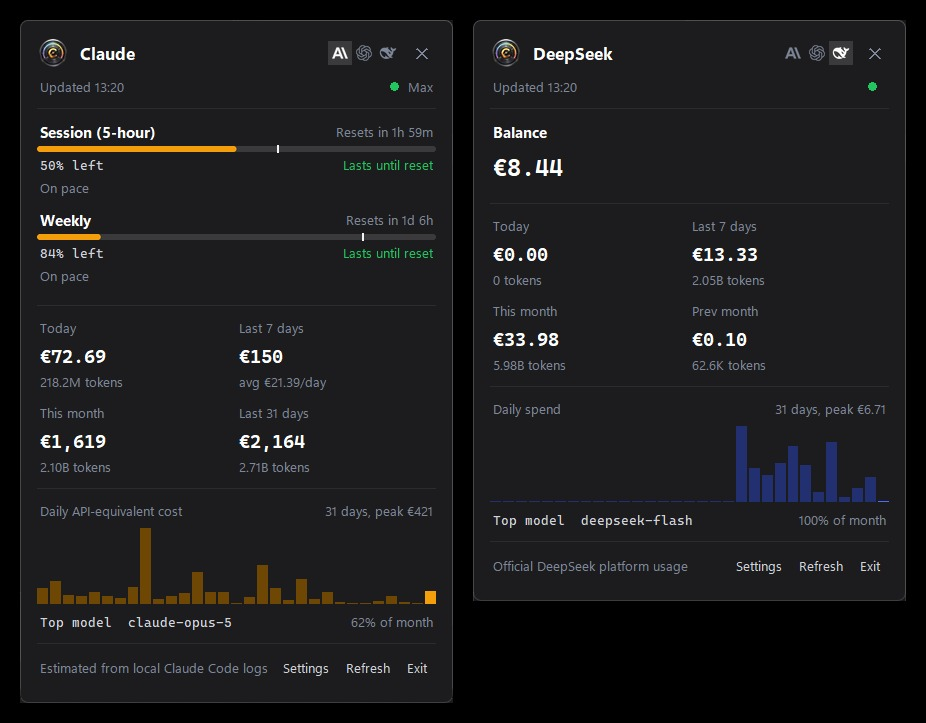
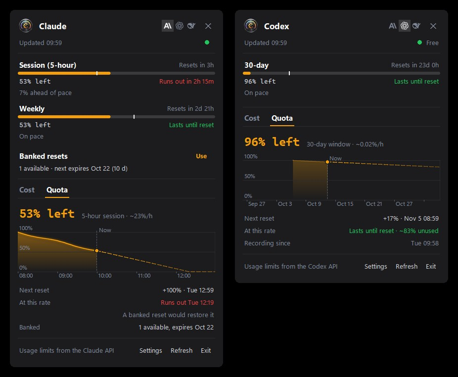

# ClaudeBar

Windows and Linux system tray app that tracks Claude Code, OpenAI Codex and DeepSeek usage. Inspired by [CodexBar](https://github.com/steipete/CodexBar), which runs only on macOS.



## What the panel shows

One engine at a time, switched with the provider logos in the header.

For each rate-limit window (5-hour session and weekly): a bar with a tick at the point an even spend would have reached, how much is left, when it resets, and whether the remaining allowance lasts until the reset or runs out first at the pace spent so far.

Below the bars: API-equivalent cost and token counts for today, the last 7 days, this month and the last 31 days, a chart of daily cost over the last 31 days, and the model that dominates the month's cost. Hover any bar in the chart to see that day's date and exact figure.

DeepSeek has no rate limits, so its view swaps the bars for the account balance and reports spend with tokens for today, the last 7 days, this month and the previous month, with the same 31-day chart.

Two labels under the limits, Cost and Quota (Spend and Balance on DeepSeek), switch the lower half of the panel. Cost is everything described above. Quota is a forecast of the 5-hour session, the limit that moves within a working day. It shows the share of the session that is left and how fast it is draining, then a chart of the session from its start to its reset (once that reset time has passed, until the next reading arrives, the view says so instead of charting the old session): the recorded quota as a glowing line over a fill that fades downward, and a dashed projection that keeps falling at the measured rate until the reset on the right edge. Underneath it says what the reset adds back, whether the quota lasts until then or runs out first and when, and how long ClaudeBar has been recording. A Codex plan without a session window charts its one long window instead: the free plan's single 30-day window is shown at its real length, stretched to its reset, and titled "30-day". On DeepSeek the same view projects the balance from the last seven days of spend.



The drain rate is the quota lost over the last two hours of a session (the last 72 hours of a longer window), ignoring the jumps that resets cause. ClaudeBar has to record those readings itself: it appends one to `quota_history.jsonl` after every successful refresh and keeps ten days. Until it holds about ten minutes of a session (six hours of a longer window) the rate is the window's own average, and the chart's glowing line starts where recording did. Before that, the window's earlier part is drawn as a softer straight line from a full quota at the window's start to the first reading, captioned "estimated".

Claude and Codex both hand out banked resets, saved one-time limit resets that expire. They are listed under the limit bars with how many there are and when the next one expires, in amber inside a week. When one can be used right now a Use button appears. It asks first, naming the reset, its expiry, what it clears and your current usage, and sends a single request only after you confirm. It is never offered from cached data, it is never retried on its own, and a result it could not learn is reported as unknown rather than guessed. Spending a reset cannot be undone, so read the confirmation.

The right-click tray menu shows a short summary of every engine without opening the panel.

## Supported engines

ClaudeBar reads OAuth tokens from the CLI credential files only.

Claude Code CLI: session and weekly limits, banked resets, tokens per model, and costs from the JSONL logs. Requires an installed and authenticated Claude Code CLI. Anthropic gives banked-reset data only to the Claude CLI's own user-agent, so ClaudeBar's one usage request identifies itself as that CLI; if Anthropic refuses the request it is repeated once as the plain call and the limits still show.

Codex CLI: session and weekly limits, banked resets, tokens, and costs from the local logs. Requires Codex CLI with `codex login` completed. The weekly slot shows whatever long window the plan has, at its own length.

DeepSeek: balance, lifetime spend, and cost and token counts for today, this month, the last 7 days and the previous month. DeepSeek is API-only, so there are no session or weekly limits to show.

Sign in once from Settings and that is the whole setup. The button opens a browser window you sign into yourself; your password stays with DeepSeek, and ClaudeBar reads only the session token that comes back. Everything shown afterwards comes from that session, through the same private endpoints the platform's own usage page calls: the balance and lifetime total from the account summary, and the daily cost, token and request counts from the usage endpoints.

The platform sits behind a JavaScript challenge, which is why signing in needs a real browser window rather than a plain HTTP request, and why the endpoints are undocumented and can change without notice. If they do, the DeepSeek view goes quiet and says so; nothing else in the app is affected.

You can also paste the session token directly, from `localStorage.getItem("userToken")` at `platform.deepseek.com`, or supply it as `DEEPSEEK_USER_TOKEN`. With no session at all the DeepSeek view opens, shows nothing, and tells you to sign in rather than displaying stale figures.

Not supported: the Claude Desktop app and the ChatGPT web interface, which authenticate with browser cookies that the usage APIs do not accept, and GitHub Copilot, whose metrics API serves organisation and enterprise accounts only.

## Install and run

**Windows** needs Windows 10 or 11 and Python 3.11 or newer. The [Releases](https://github.com/MarvinFS/Public/releases) page has a signed installer if you would rather skip Python.

```powershell
pip install -r requirements.txt
python src/main.py
```

**Linux** needs nothing installed. Every release carries a single self-contained executable, plus `.deb`, `.rpm` and AppImage packages, built for Ubuntu 24.04, Rocky 10 and anything newer. All of them are signed, and `SHA256SUMS` with its detached signature is attached to the same release.

```bash
chmod +x ClaudeBar          # if your downloader dropped the bit
./ClaudeBar
```

The app starts in the tray. Left-click the icon to open the panel, right-click for the menu. Escape closes the panel.

## Build the executable

```powershell
.\build.ps1            # writes dist\ClaudeBar.exe, about 20 MB
.\build.ps1 -Install   # also copies it to the Startup folder
.\build.ps1 -Clean     # rebuilds from scratch
```

To use your own icon, put `app_icon.png` (tray and header) and `app_icon.ico` (the exe) in `resources/icons/`.

## Configuration

The paths in this section and the next are the Windows ones. On Linux they follow the XDG directories instead: `~/.config/claudebar/config.json`, `~/.local/state/claudebar/claudebar.log`, `~/.cache/claudebar/` for the caches, and `~/.local/share/claudebar/secrets/` for the DeepSeek token, which is held in the desktop keyring rather than DPAPI.

Settings live in `%LOCALAPPDATA%\ClaudeBar\config.json`:

```json
{
  "refresh_interval": 300,
  "warning_threshold": 80,
  "critical_threshold": 95,
  "currency": "USD",
  "claude_enabled": true,
  "codex_enabled": true,
  "deepseek_enabled": true,
  "window_x": null,
  "window_y": null,
  "panel_view": "cost"
}
```

`panel_view` is `cost` or `forecast`, the half of the panel you last chose. `refresh_interval` is in seconds, and never less than 30. Past the two thresholds the tray icon gets an amber, then a red, corner badge. `currency` accepts USD, EUR, GBP, RUB, or RON. The engine toggles hide an engine you do not use. `window_x` and `window_y` hold the last dragged panel position.

DeepSeek credentials are never written to `config.json`. The session token is encrypted with Windows DPAPI, which ties it to your Windows account, and stored in `%LOCALAPPDATA%\ClaudeBar\secrets\`. Copying that folder to another machine or user profile yields nothing. If DPAPI is unavailable the token is kept in memory for that session only.

## Logs

The log is `%LOCALAPPDATA%\ClaudeBar\claudebar.log`, and "Open log file" in the tray menu opens it directly.

It records changes of state, not every refresh: the app starting and exiting, a source that stopped working and what it said, the recovery when it returns, and how long it was down. Routine successes stay out, so a quiet file is a healthy one. When you want the per-refresh detail back for a session, start the exe with `--debug`:

```powershell
ClaudeBar.exe --debug
```

The file is UTF-8. It rotates at midnight into `claudebar.log.YYYY-MM-DD` and files older than 14 days are deleted. A single day is capped at 1 MB, and a day that reaches the cap rolls into a numbered file rather than growing without bound.

## Where the numbers come from

Rate limits come from the Anthropic OAuth API, with the token from `~/.claude/.credentials.json`, and from the ChatGPT backend API, with the token from `~/.codex/auth.json`. Tokens and costs come from the JSONL logs in `~/.claude/projects/` and `~/.codex/`.

Banked resets come with the same two calls: the `cedar_ember` block of Anthropic's usage response, and the `rate_limit_reset_credits` count in the ChatGPT usage response, with one extra request for the list when that count is above zero. Spending one is a separate, explicit request: Anthropic's organisation reset endpoint, or the ChatGPT reset-credit consume endpoint. Nothing else in ClaudeBar writes to either service.

The quota forecast is drawn from `%LOCALAPPDATA%\ClaudeBar\quota_history.jsonl`, one line per provider per successful refresh, with anything older than ten days dropped. It is only written from live responses, never from the cached fallback.

Costs are API-equivalent estimates, not subscription charges: every token is priced at what the same call would cost on the public API. Rates come from models.dev, downloaded at most once a day and cached at `%LOCALAPPDATA%\ClaudeBar\models_dev.json`. Until a download has succeeded the bundled tables apply. Claude 1-hour cache writes cost 2x the input rate and 5-minute writes 1.25x. OpenAI requests with more than 272K input tokens use the long-context tier. Models from other providers, such as a local model through Codex, count towards tokens but not cost.

DeepSeek is the exception to estimating. Its balance comes from `api.deepseek.com/user/balance`, and its cost, tokens and request counts come from the platform's own usage endpoints, so those figures are the billed ones rather than an estimate. The panel says which of the two it is showing.

One consequence of reading the platform's own counters: it buckets each day in UTC, and so does ClaudeBar's DeepSeek view, which is why the figures match the usage page exactly. West of UTC that means "Today" can still read zero after local midnight, until the platform's day rolls over. The month, the 7-day series and the weekly token total are unaffected.

## Expired tokens

Claude OAuth tokens last about 8 hours. When the token has expired the panel keeps showing the last data, marked with an amber "cached from 2h ago", from `%LOCALAPPDATA%\ClaudeBar\snapshot_cache.json`. To get a fresh token, open Claude Code in any terminal: it refreshes the token on startup. ClaudeBar reads Claude and Codex credentials but never writes or refreshes them; the DeepSeek credentials you enter are the only ones it stores, encrypted as described above.

## Troubleshooting

If the tray icon is missing, open the taskbar overflow arrow. Windows hides new tray icons by default.

If no Claude data appears, use Claude Code once so that `~/.claude/projects/` exists, and run `claude /usage` to check that the CLI is signed in.

If the Codex view shows an error, install Codex CLI and run `codex login`.

If the DeepSeek view shows a balance but no usage, the platform token is missing or has expired: sign in at `platform.deepseek.com` again and paste a fresh `userToken` into Settings. Platform sessions expire on their own schedule, and the panel reports it as "Session expired".

If something else looks wrong, open the log from the tray menu. It says which failure it hit, such as an OAuth token that expired at a given time or a credentials file that is missing, instead of leaving you to guess from a stale panel.

The panel opens near the tray on the primary monitor. Drag it anywhere and it stays there across restarts. If that spot is no longer on any monitor when the app starts, the panel returns to the default position. "Reset window position" in the tray menu does the same on demand.

## License

MIT
